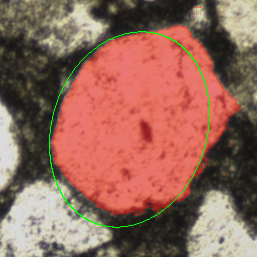
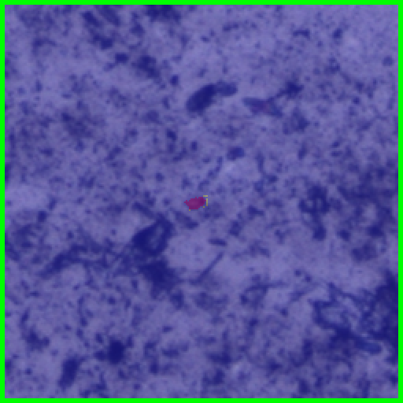
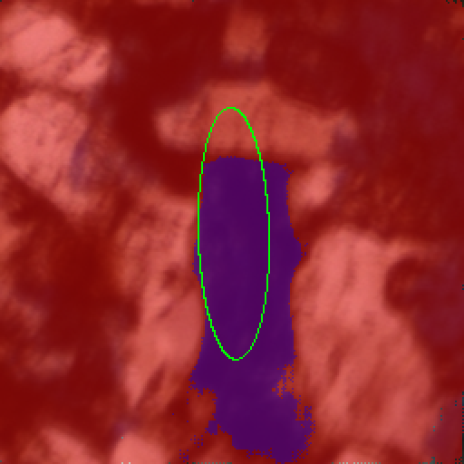
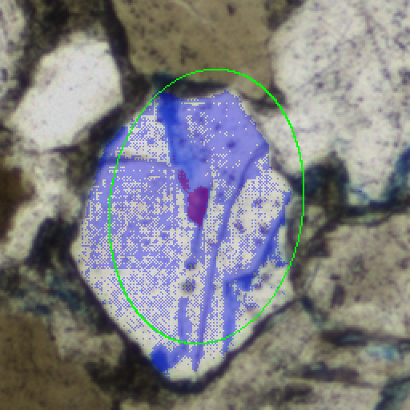

# Thin-section mineral identification with SAM2 (LITHOS)

Patch-level mineral identification on rock thin sections: SAM2 cuts out the
central grain from a 256×256 polarised-light patch, and a frozen-ResNet18
linear probe predicts the mineral (25 classes). A public-dataset
reproduction of the kind of work in the author's portfolio.

> **Honest statement — read this first.** This demo reproduces the *type* of
> work the author has done (SAM2/SAM3 thin-section mineral identification)
> on a **public dataset (LITHOS)**. It is **not** the author's private
> project data, and it does **not** use SAM3. The numbers below are modest
> on purpose: the dataset's own paper baseline is weak on the same task,
> and SAM2 zero-shot on polarised-light microscopy is weaker still. The
> point of this demo is to show the pipeline end to end and to measure
> honestly where it breaks.

## What it does

```
LITHOS patch (PPL 256x256, one grain centred)
  -> SAM2.1-hiera-tiny, centre-point prompt (128, 128) -> central-grain mask
  -> ResNet18 (ImageNet, frozen) features of the whole patch (PPL + XPL)
  -> logistic regression -> 25-class mineral label + confidence
```

* **Segmentation** is evaluated against GT masks (see "Ground truth" below).
* **Classification** uses whole-patch features, exactly like the LITHOS
  paper's baseline — it does **not** depend on the SAM mask, because the
  SAM mask is too unreliable to crop with (measured below).
* Streamlit demo (`app.py`): pick a patch or upload your own thin-section
  crop, toggle PPL/XPL, see the SAM mask and the predicted mineral.

## Dataset — LITHOS

* Source: Chacón, Ruiz Puentes, Pearse & Arbeláez, "Towards Automated
  Petrography", NeurIPS 2025 Datasets & Benchmarks.
  Paper: https://arxiv.org/abs/2511.00328 ·
  Data: https://www.kaggle.com/datasets/paolaruizpuentes/lithos-dataset ·
  Code (MIT): https://github.com/BCV-Uniandes/LITHOS
* 105,802 expert-annotated grains / 211,604 paired PPL+XPL patches
  (256×256) / 25 mineral classes / 580 thin sections. Splits are by thin
  section (Fold 1 / Fold 2), so no thin section leaks across the split.
* **Licence: CC BY-NC-SA 4.0** — non-commercial portfolio demo only,
  attribution required, derivatives under the same licence. The dataset
  itself is **not** in this repo: `data/` is gitignored except
  `data/lithos.yaml` (subset definition) and `data/index.csv` (grain list).
  Only a few eval patches are shown in `assets/` as examples.
* Subset used here (see `data/lithos.yaml`): train = Fold 1, stratified,
  cap 120/class → 2,812 grains; eval = Fold 2, stratified, cap 40/class
  → 1,000 grains; SAM eval = 300 of the eval grains. Classes follow the
  official LITHOS 25-class scheme (raw labels 4 Orthoclase, 21 Biotite,
  25 Olivine, 26 Intraclast are folded into "Other").
* Note: several "classes" are grain *types* rather than pure minerals
  (e.g. Rock fragment, Fossil fragment, Foraminifer) — the task is
  petrographic grain identification, not pure mineralogy.

## Ground truth — read this before trusting the IoU numbers

LITHOS does **not** ship grain-boundary polygons. Each grain folder has a
`center_component.csv` with two SVG path elements (`path_1`, `path_2`).
Checking them against the paper supplement and against 2,000 grains shows
they are the grain's **major/minor axis segments**, not a boundary:

* each path is a single straight segment (`M x1,y1 L x2,y2`), in
  coordinates normalised by the mosaic width;
* the two segments are exactly perpendicular (median angle 90.00°);
* their length ratio matches the CSV major-axis / minor-axis ratio
  (median relative error 0.16%);
* both pass through `(x_inter, y_inter)`, the grain centre.

The "unexplained 24786" in the supplement is the width in pixels of the
original thin-section mosaic: the 256×256 patch is a 1:1 crop of it,
centred on `(x_inter, y_inter)`. Conversion (supplement Listing 1):
`patch = path * 24786 + (128 - x_inter)`.

**GT masks are therefore ellipses fitted through the four axis endpoints**
(`scripts/build_gt_masks.py`), centred on (128, 128). A 10-patch visual
check (`assets/verify/*_overlay.png`) confirms they land on the central
grain: 7 good fits, 2 fair (irregular/angular grains where the ellipse
overshoots ~10–20% into neighbouring material), 2 whole-patch (grain
bigger than the patch — the mask correctly covers the frame). Mean mask
area is 45% of the patch (median 30%).

Consequence: **mean IoU measures agreement with the elliptical
approximation, not with a hand-drawn boundary.** Irregular grains cap it
below 1.0 even for a perfect segmenter, and ~30% of eval grains are
bigger than the patch (whole-patch masks, reported separately).

## Results

### Classification — Fold 2 eval, n = 1,000 (40/class)

Frozen ResNet18 (ImageNet) features + logistic regression
(`scripts/train_probe.py`). Trained on Fold 1 (2,812 grains).

| Features | 25-class accuracy | 25-class macro-F1 | Quartz vs rest |
|---|---|---|---|
| PPL only | 0.229 | 0.228 | 0.865 |
| **PPL + XPL** | **0.319** | **0.319** | **0.872** |

XPL adds ~9 points of accuracy — consistent with the paper (e.g. the
grid twinning of microcline is only visible under crossed polars).
Per-class (PPL+XPL, full table in
`runs/probe/classification_report.txt`): best are Dolomite (F1 0.68),
Sanidine (0.60), Foraminifer (0.58), Red algae (0.56); worst are Other
(0.07), Fossil fragment (0.10), Feldspar (0.11), Heavy mineral (0.11).
Quartz recall is only 0.325 — the paper's own trained dual-encoder ViT
baseline gets ~0.49–0.55, so a frozen-feature probe landing lower is
expected, not a bug. The hard group is Monocrystalline / Rock fragment /
Polycrystalline / Feldspar / Quartz, which confuse each other heavily
(see `runs/probe/confusion_matrix.png`).

### Segmentation — SAM2 centre-point, 300 eval grains

SAM2.1-hiera-tiny, one centre-point prompt per patch, CPU
(`scripts/segment.py`). SAM returns 3 masks per prompt; the scores are
**not** sorted, and on thin sections they do not rank masks correctly —
so two numbers are reported:

| | mean IoU | median IoU | IoU > 0.5 | IoU > 0.75 |
|---|---|---|---|---|
| **Top-scored mask** (standard SAM usage — the honest headline) | 0.434 | 0.324 | 36.3% | 29.0% |
| Best of 3 (oracle upper bound) | 0.609 | 0.574 | 53.7% | 39.0% |

31% of eval grains (93/300) are bigger than the patch, so their GT mask
is the whole frame and any "segment everything" mask scores ~1.0.
Excluding those (n = 207), the numbers fall to **0.287 (top-scored) /
0.445 (oracle)** — that is the honest figure for grains smaller than the
patch. Only 17.9% of those reach IoU > 0.5 with the top-scored mask.

The gap between the two rows is the main finding: **SAM often proposes
a usable mask but ranks a speck first.** The top-scored mask is a
<1%-area speck in many failures while another of the 3 masks covers the
grain (see Bad case 1). Per class (excl. whole-patch, small n per class):
best Calcite 0.74 (n=4), Sanidine 0.61 (n=3); worst Foraminifer 0.05
(n=2), Crystalline mosaic 0.09, Quartz 0.15. Timing: mean 14.1 s/image
over the batch run (8.0–35.5 s; the batch shared the CPU with the probe
training — unloaded single-image timing is ~9–11 s, smoke test 11.1 s).

For contrast, a case where it works — Feldspar, IoU 0.80:



(Red = SAM top-scored mask, green = GT ellipse outline, blue = oracle
mask when it differs from the top-scored one.)

## Bad cases

**1. Ranking failure, not segmentation failure — Plagioclase, argmax IoU
0.001 / oracle 0.999.**

SAM proposed the whole grain (blue, whole frame — GT is the whole patch,
green frame) but ranked a 0.1%-area speck first (tiny red dot near the
centre). The model saw the grain; its confidence score did not.

**2. Top mask is the whole patch — Mica, argmax IoU 0.065 / oracle 0.404.**

The grain is a thin dark sliver (green ellipse, 6.5% of the patch). SAM's
top mask covers 99.8% of the patch (red). Even the best proposal only
reaches 0.40 — thin, low-contrast grains are the hardest shape here.

**3. Thin grain, best proposal still poor — Quartz, argmax IoU 0.018 /
oracle 0.485.**

Top mask is again a speck (red dot at centre); the best of the 3 (blue)
covers about half the white quartz grain (green outline) and spills over
its edge. Quartz is the worst class for SAM here (mean IoU 0.15 excl.
whole-patch) even though it is the binary headline class for the
classifier — segmentation and classification fail on different grains.

Classification bad cases follow the same pattern as the paper: the
confusion matrix (`assets/confusion_matrix.png`) shows the hard group
Monocrystalline / Rock fragment / Polycrystalline / Feldspar / Quartz
confusing each other, while distinctive textures (Foraminifer, Red
algae, Dolomite, Sanidine) are recognised well.

## Why SAM2, not SAM3

The author's real project also used SAM3, but this demo uses
SAM2.1-hiera-tiny deliberately: SAM3 is gated access (request + SAM
License), has 848M parameters, and officially requires a CUDA GPU —
none of which fits a CPU-only, fully reproducible portfolio demo. SAM2 is
Apache 2.0, ungated, 38.9M parameters, and runs on CPU (~11 s/image
here). SAM3's text-concept prompting ("find all quartz") is the natural
follow-up; it is listed under Future work, not claimed here.

## Reproduce

```bash
# 1. Python 3.12 venv; install torch CPU first (mirror, see requirements.txt)
pip install -r requirements.txt
# 2. SAM2 from source (not on PyPI) into smoke-test/sam2-main:
curl -L -o sam2.zip https://codeload.github.com/facebookresearch/sam2/zip/refs/heads/main
mkdir -p smoke-test && unzip sam2.zip -d smoke-test   # -> smoke-test/sam2-main/
SAM2_BUILD_CUDA=0 pip install --no-build-isolation -e ./smoke-test/sam2-main
# 3. LITHOS (needs a Kaggle account + API token):
kaggle datasets download paolaruizpuentes/lithos-dataset   # ~20 GB
# 4. Subset + GT masks (only the subset is unzipped, ~730 MB):
python scripts/prepare_data.py
python scripts/build_gt_masks.py --index data/index.csv --split eval \
    --subset-root data/subset/eval --out data/masks_eval
python scripts/build_gt_masks.py --index data/index.csv --split train \
    --subset-root data/subset/train --out data/masks_train
# 5. SAM eval (~55 min for 300 patches on 4 vCPU) + probe (~45 min):
python scripts/segment.py
python scripts/train_probe.py
python scripts/evaluate.py
# 6. Demo:
streamlit run app.py
```

Weights are downloaded by the scripts on first run (SAM2 checkpoint,
ResNet18 ImageNet weights) and are **not** committed.

## Future work

* SAM3 text-prompt segmentation ("quartz") once GPU access is available.
* Fine-tuning the classifier (or a small ViT) on the full Fold 1 instead
  of a frozen-feature probe; the paper's dual-encoder PolarViT is the
  reference to beat.
* A better GT: the ellipse is an approximation — hand-checking a sample
  of irregular grains, or fitting a convex hull from the axis endpoints
  plus edge evidence, would tighten the IoU measurement.
* Box-prompt SAM eval: the centre-point numbers below conflate "SAM
  can't find the grain" with "SAM found it but ranked another mask
  first" — a box prompt separates the two.

## Licence & attribution

* Code in this repo: MIT (same as Demo 1).
* LITHOS data: CC BY-NC-SA 4.0 (Chacón et al., NeurIPS 2025). If you use
  it, cite the paper and respect the non-commercial / share-alike terms.
* SAM2 code + weights: Apache 2.0 (Meta).
